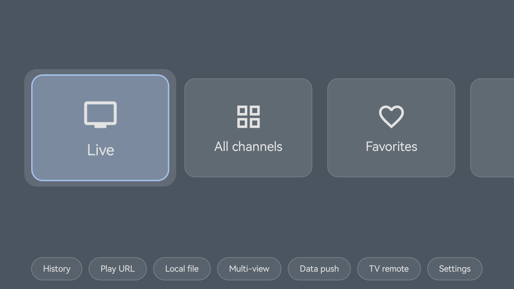
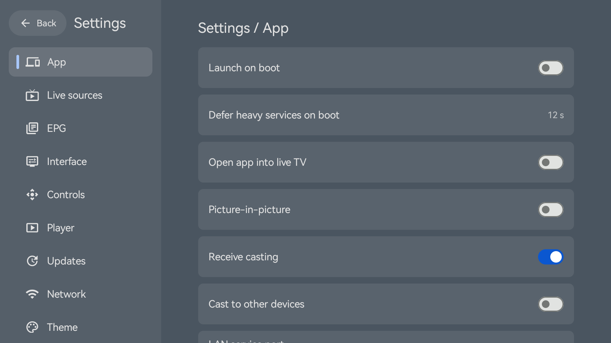
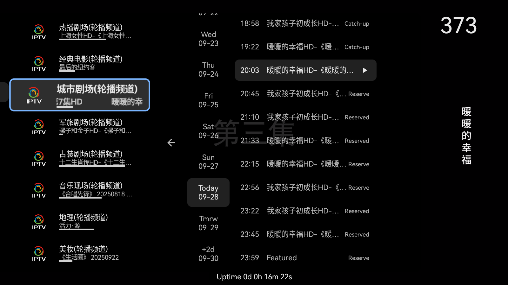
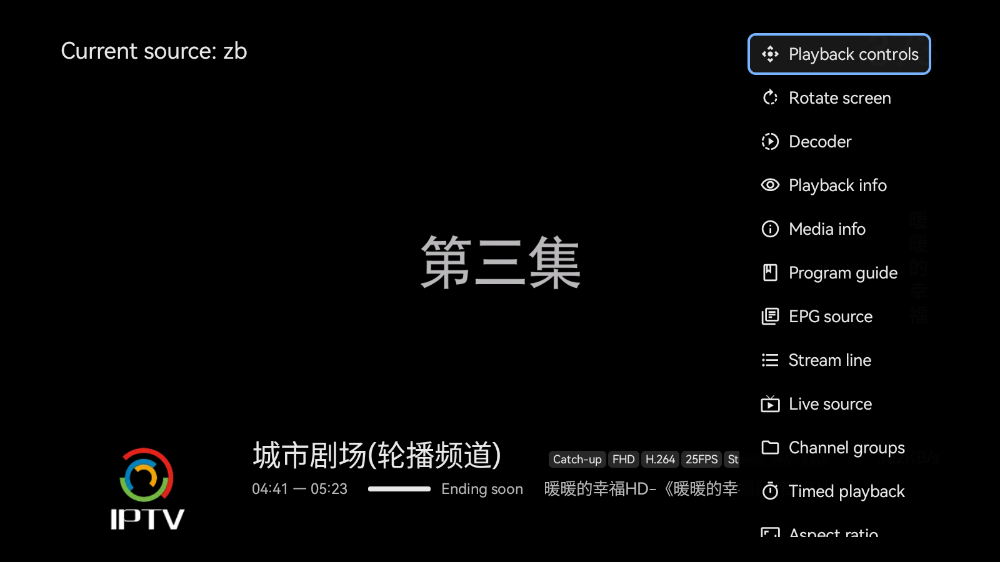
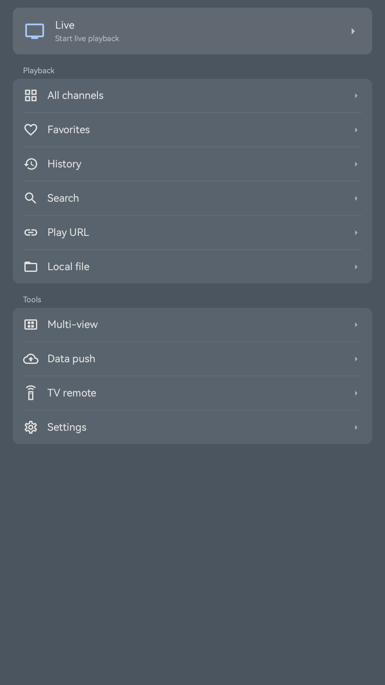
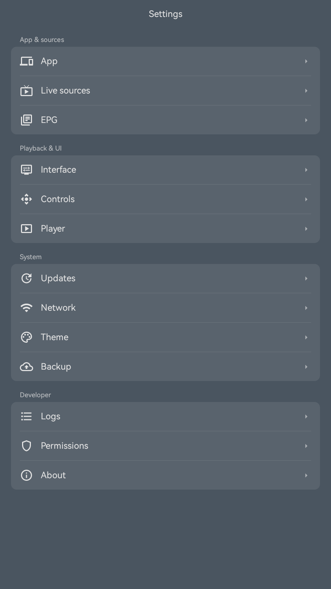
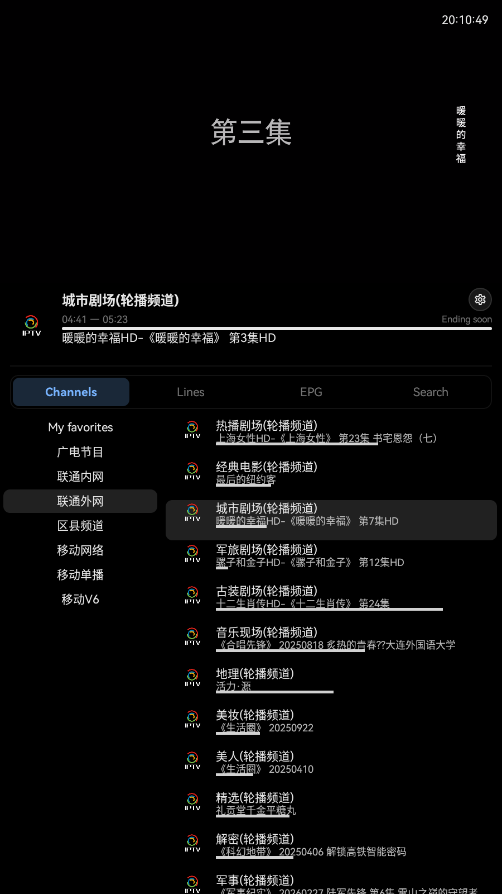
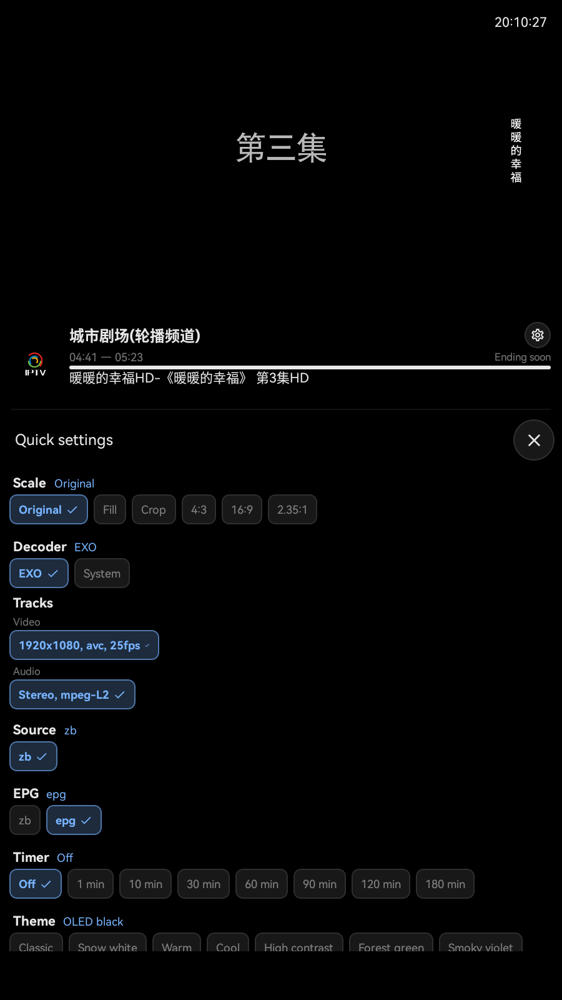

# Ylive — User Guide & Documentation

[English](./README.en.md) · [简体中文](./README.md)

Related docs: [Catchup Manual (Chinese)](./回看使用手册.md) · [Voice Control via XiaoAI (Chinese)](./小米音响小爱同学语音换台接口文档.md) · [Custom JS Playback Scripts (Chinese)](./播放脚本JS编写说明.md) · [Custom PHP Playback Scripts (Chinese)](./播放脚本PHP说明.md)

---

## 1. Overview

**Ylive** is a lightweight, full-featured live IPTV player designed for **Android TV, TV boxes, automotive head units (In-Vehicle Android), smartphones, and tablets**.

The application itself **does not provide, store, distribute, or operate** any audio/video channels or content. It serves purely as a multimedia playback client for third-party streams and sources configured by the user.

### Key Use Cases

- Use remote control or touch screen on TVs and car head units to switch channels, inspect EPG guides, and change stream lines.
- Browse channel categories and favorite channels in portrait layout on smartphones and tablets.
- Control playback, switch channels, or push configurations to TV/car devices via browser or another device within the same local network.
- Voice-activated channel switching using **XiaoAI / Home Assistant** through local HTTP REST APIs.
- Stream video to TV via DLNA, or cast playback from TV to other DLNA devices.
- Direct link playback and local media file playback.
- HLS streams accessible only through **SOCKS5 / HTTP proxies** (see §3.5).

### System Requirements

| Item | Details |
| --- | --- |
| OS Version | Android 6.0 (API level 23) or higher |
| Device Types | Android TV, TV boxes, **Car Head Units (Android)**, smartphones, tablets |
| Network | Stable connection for online streaming; LAN features require devices on the same Wi-Fi/LAN |

> **Notes for Car Head Units:** Optimized for Android-based infotainment dashboards in **landscape mode**, supporting touch gestures and D-pad/steering keys. Some automotive systems require enabling "Install from Unknown Sources", autostart, and background activity permissions. For traffic safety, never operate the display while driving.

### UI Preview

The following previews demonstrate the TV/Car landscape interface and Phone portrait interface.

#### TV / Box / Automotive (Landscape)

**Home Dashboard** — Top navigation for "Live / All Channels / Favorites", bottom grid for History, URL Play, and Settings:



**Settings** — App, IPTV Sources, EPG, UI & Display, Player Engines, Theme customization:



**Channel List & EPG Guide** — Expand channel drawer and program guide during playback, browse schedules, and reserve upcoming shows:



**Playback Controls & Quick Panel** — Right-hand side drawer during playback for timeline, decoder, audio/subtitle tracks, aspect ratio, and line selection:



#### Phone / Tablet (Portrait)

**Home** — Prominent "Live" entrance at top with playback and utility categories below:



**Settings** — Categorized preferences for Application, Sources, Display, and System:



**Channel & Program Guide** — Live stream on top half, daily EPG schedule with catchup / reservation on bottom:



**Quick Playback Settings** — On-screen overlay to change aspect ratio, decoder engine, stream line, and tracks:



---

## 2. Getting Started

### 1. Installation

Download the official APK release for your CPU architecture (`arm64-v8a` recommended, or `armeabi-v7a` for older boxes). If prompted by the system, allow installation from "Unknown Sources".

### 2. Terms of Use

On the first launch, the app displays the **Terms of Service & Usage Notice**. Please read carefully. Tap "Agree & Continue" to proceed.

### 3. Screen Orientation

On phones, you can choose **Portrait** mode at initial launch. Automotive head units and TVs default to **Landscape** mode. You can adjust this anytime in **Settings → App → Screen Orientation**.

### 4. Adding IPTV Sources

The application does not include preloaded channels. Prepare valid M3U or TXT playlists and add them under **Settings → IPTV Sources**:

- Remote URL (HTTP/HTTPS)
- Local File (Internal storage or external flash drive via SAF file picker)
- Direct text content pasting

After enabling the source, return to the Home page and select **Live** to load channels.

### 5. EPG (Program Guide, Optional)

To display current and upcoming program titles, configure EPG source URLs in **Settings → EPG Sources**. EPG data is loaded and cached independently from IPTV playlists.

If the channel provider supports timeshift/catchup, past programs can be replayed directly from the EPG schedule (see [Catchup Manual](./回看使用手册.md)).

---

## 3. Core Features

### 3.1 Dashboard & Navigation

- **Landscape (TV / Automotive)**: Top menu for "Live / All Channels / Favorites", bottom grid for History, URL Play, Local File Play, Multi-View, Data Push, Remote Control, and Settings.
- **Portrait (Smartphone)**: Top "Live" banner, clean list view separating playback actions, management tools, and settings.

### 3.2 Live Playback & Channel Selection

- Grouped channel navigation; navigate with remote arrow keys and press OK/Enter to switch.
- Side quick panel for line switching, track selection, and channel metadata.
- Interactive EPG program guide supporting date switching, catchup playback, and reminder scheduling.
- Channel favorites, custom channel aliases, and playback history.

### 3.3 Multiple Player Engines

Ylive bundles multiple playback engines that can be switched in **Settings → Player**:

| Engine | Best For |
| --- | --- |
| **ExoPlayer (Media3)** | Default engine, low latency, optimal for common HLS and MP4 streams |
| **MPV** | Advanced video codecs, AV3A audio, custom shaders, high compatibility |
| **IJK (FFmpeg)** | Stable playback on diverse IPTV live streams, AV3A support |
| **VLC 4** | Broad legacy protocol and format support |
| **System MediaPlayer** | Lightweight fallback engine |

### 3.4 Direct URL & Local Playback

- Play custom stream URLs (`http`, `https`, `rtsp`, `udp`, `rtp`).
- Browse and play local media files from internal storage, SD cards, or USB drives.
- Supports system intent "Open With" integration.

### 3.5 SOCKS5 / HTTP Proxy Streams

For live streams that require proxy tunneling to bypass network restrictions, Ylive supports the dedicated scheme **`ylive://play`** (compatible with short forms `sk://`, `socks://`, `socks5://`). The app routes stream manifests and transport chunks locally through your proxy:

```text
# Standard format
ylive://play?proxy=<proxy_url>&url=<url_encoded_target_stream>

# Short formats
sk://<proxy_host:port>&url=<target_stream>
socks5://<proxy_host:port>&url=<target_stream>
```

**Example:**
```text
CCTV-6,ylive://play?proxy=socks5://1.2.3.4:1080&url=http%3A%2F%2Fexample.com%2Flive%2Fcctv6.m3u8$Proxy Line
```

### 3.6 DLNA Casting

Under **Settings → App**:
- **DMR (Receiver)**: Allow other devices (e.g. smartphones) to discover the TV and cast video to it.
- **DMC (Sender)**: Stream the currently playing channel to other DLNA renderers in the local network.

### 3.7 Local Network Remote Control & API

#### Browser Control
Access the device's web console from any computer or mobile browser on the same Wi-Fi:
```text
http://<DEVICE_IP>:8888/
```
(Default port is `8888`, configurable in Settings). You can change channels, push stream URLs, and access the Web Advanced Settings dashboard (`/advance`).

#### In-App Remote
On another smartphone running Ylive, tap **TV Remote**, scan the QR code on the TV's Data Push page or enter the TV's IP to control playback remotely.

#### Smart Home & XiaoAI Voice Control (Home Assistant)
Control Ylive hands-free via REST APIs:
- Play by channel name: `GET http://<TV_IP>:8888/api/channel/play?name=CCTV1`
- Next / Previous channel: `GET .../api/channel/next` · `GET .../api/channel/prev`
- Query channel list: `GET http://<TV_IP>:8888/api/channels`

### 3.8 Multi-View Playback

Play multiple streams concurrently on a single display in grid view, ideal for multi-camera feeds or comparative monitoring.

### 3.9 Cloud Sync & Backup

Backup channel playlists, favorite channels, and preferences to:
- Local storage
- WebDAV cloud servers

### 3.10 Wallpaper & Themes

- **Splash Wallpaper**: Configure independent landscape and portrait splash screens. Supports **Bing Daily Wallpaper** caching.
- **App Themes**: Preset color schemes, Bing Daily, solid custom colors, or custom background image textures.
- **Playback UI Styling**: Adjustable overlay colors, accent highlights, and panel opacity.

---

## 4. Troubleshooting & FAQ

### 1. Stream fails to load or buffers continuously
- Switch stream lines in the channel quick panel.
- Change player engine (e.g. switch between ExoPlayer, MPV, and IJK).
- Verify the playlist URL is active and accessible.

### 2. Cannot connect to Local Web Remote
- Ensure both devices are connected to the same Wi-Fi network and AP Isolation is disabled on the router.
- Verify the port configured in **Settings → App → LAN Service Port** (default `8888`).

### 3. Missing Program Guide (EPG)
- Check that the EPG source is reachable and channel names in the playlist match the XMLTV/JSON channel definitions.

---

## 5. Privacy & Data Handling

To improve stability, the app may collect anonymous diagnostic information:
- Device model, Android OS version, and app version.
- Crash trace logs (only upon exception or user submission).

The application **never** collects, uploads, or logs your personal viewing history, channel playlists, or media content.

---

## 6. Feedback & Community

- QQ Community Group: Join via [Y影音交流反馈 (QQ Group 480988885)](http://qm.qq.com/cgi-bin/qm/qr?_wv=1027&k=KWYvkiEVgshZgnxg1UfYsXcuQZ2rk7hm&authKey=DHejsplWLDj5IrF4KqWcZmEkRNAQ5gLaejp7VfGN50vv7D0U3neh9M49olz90YKi&noverify=0&group_code=480988885)
- GitHub Project: <https://github.com/usertest001/Ylive>

---

## 7. Open Source Acknowledgments

Ylive builds upon and benefits from the following excellent open-source projects:

| Category | Project | Note |
| --- | --- | --- |
| Architectural Reference | [mytv-android](https://github.com/yaoxieyao/mytv-android) | Foundational reference for IPTV architectures |
| Player Core | [ijkplayer](https://github.com/bilibili/ijkplayer) | IJK playback engine |
| Player Core | [mpv-android](https://github.com/mpv-android/mpv-android) | MPV playback engine |
| Player Core | [VLC](https://www.videolan.org/) | VLC playback engine |
| Codecs | [FFmpeg](https://ffmpeg.org/) | Core multimedia decoding capabilities |

*All referenced libraries are subject to their respective original licenses. Ylive is not distributed under a general open-source license.*
